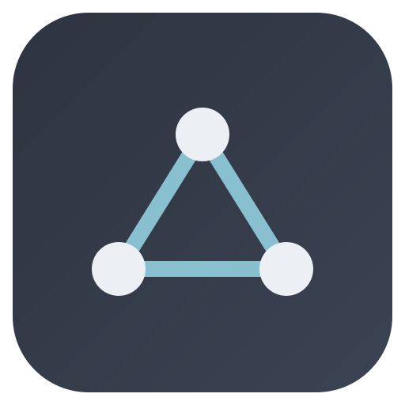
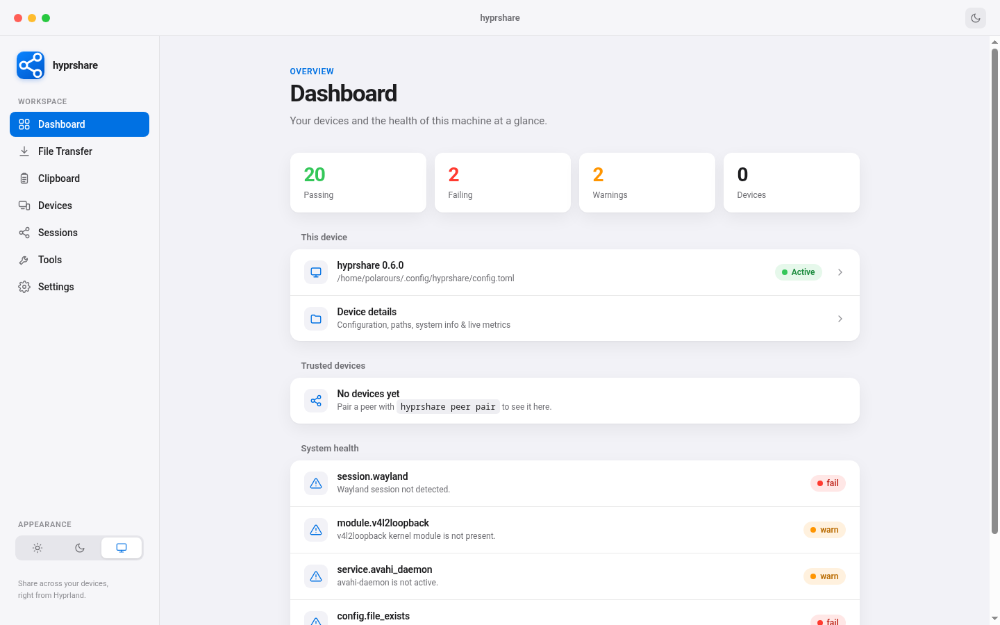
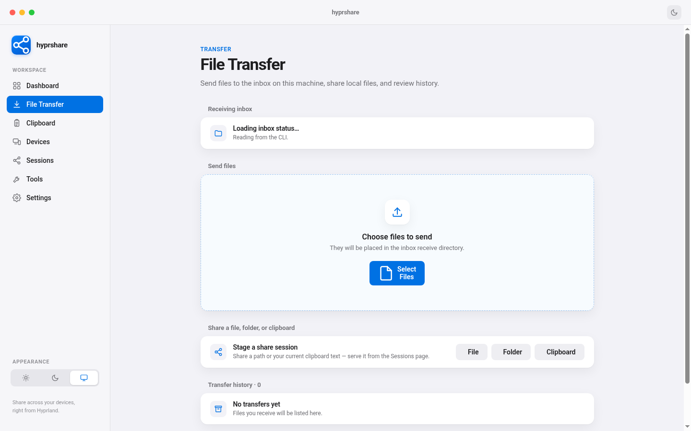
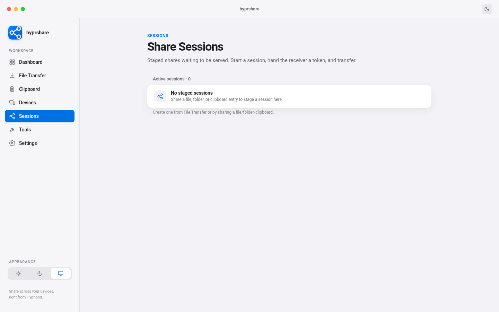
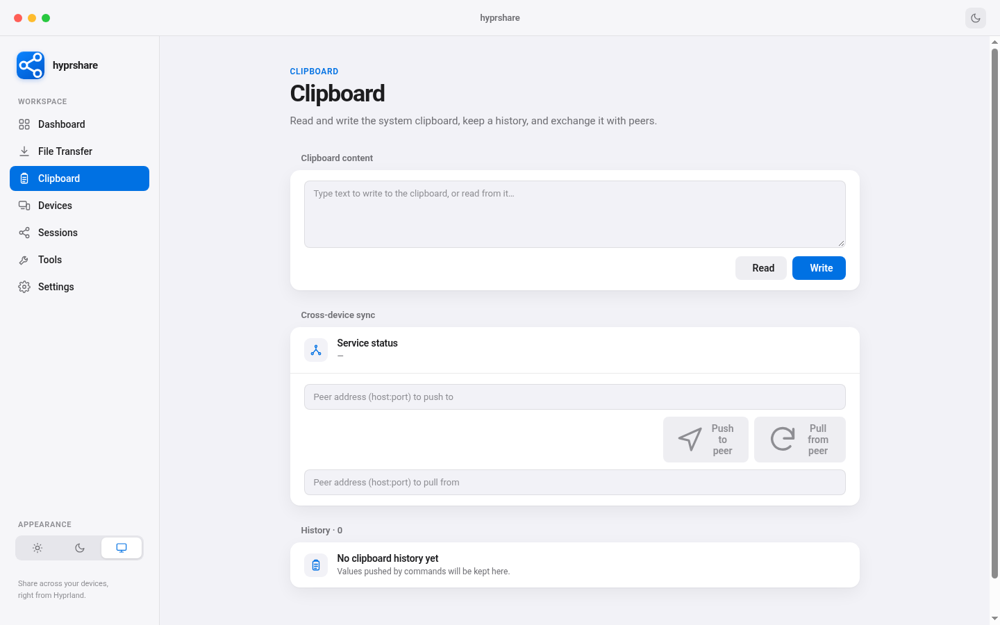
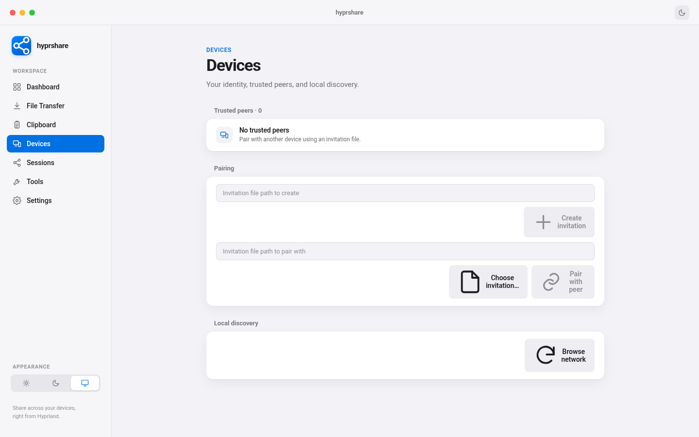
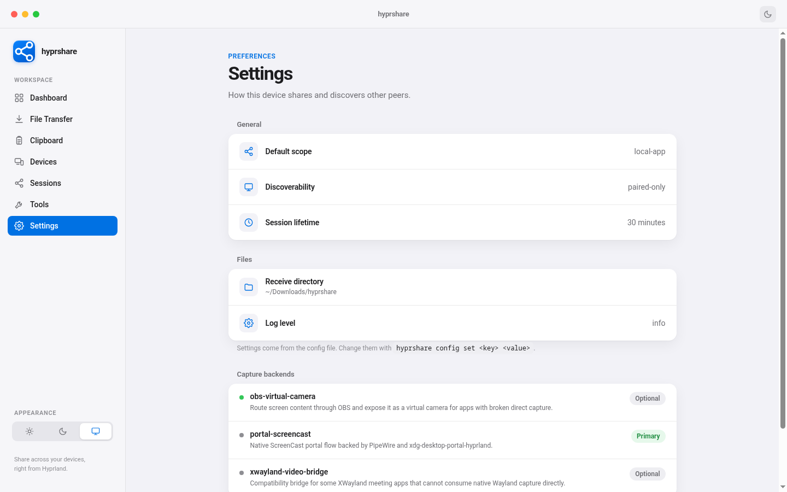
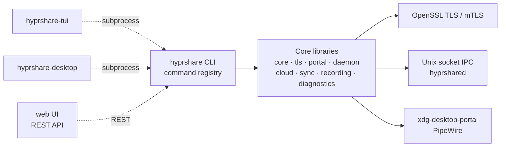

<a id="readme-top"></a>

<div align="center">



# hyprshare

### Share anything, from the terminal to the desktop — without leaving Hyprland.

[](https://github.com/polarours/hyprshare/stargazers)
[](LICENSE)
[](docs/compatibility/matrix.md)
[](CMakeLists.txt)

**[Install](#install)** &nbsp;·&nbsp; **[Features](#features)** &nbsp;·&nbsp; **[Screenshots](#screenshots)** &nbsp;·&nbsp; **[Quick start](#quick-start)** &nbsp;·&nbsp; **[Docs](#documentation)**

<br />



</div>

<br />

## ✨ TLDR

> **hyprshare** is a Linux-native sharing platform for **Hyprland** and **Wayland**.
> It unifies file transfer, clipboard exchange, screen capture, peer trust, and
> system diagnostics behind a single CLI-first core. One install gives you four
> front-ends over the same commands — the **CLI**, a **TUI**, a **desktop GUI**,
> and a **web UI**.

- 🚀 **Actively developed** — C++23 core, strict warnings, 13 test suites
- 🖥️ **Four front-ends, one brain** — every frontend calls the same CLI
- 🔐 **No cloud, no account** — device identity, offline pairing, TLS/mTLS
- 🧩 **Extensible** — shared-object plugins add CLI commands at runtime

## 🔓 Unlock the full power

<h3 align="center">Share a file in one command. Serve it with a token. Done.</h3>

```bash
hyprshare share file photo.jpg                    # stage a session
hyprshare session serve <id> --generate-token     # serve it to your LAN
hyprshare session fetch <host:port> --token <t> --to ~/recv   # receive on the peer
```

No account, no relay, no copy-pasting IPs into a browser. Sessions carry their
own checksums and can be verified on the receiving side.

## 🎯 Features

<table>
  <tr>
    <td width="50%" valign="top">
      <b>📦 File & folder sharing</b><br/>
      Stage a session, serve it with a token and lifetime, fetch from the peer.
      Checksums and payload verification built in.
    </td>
    <td width="50%" valign="top">
      <b>📥 HTTP inbox</b><br/>
      Receive uploads over LAN with token auth, extraction, size limits, and a
      persistent transfer history.
    </td>
  </tr>
  <tr>
    <td width="50%" valign="top">
      <b>📋 Clipboard</b><br/>
      Read/write and cross-device sync with persistent history — share the
      current clipboard as a session in one click.
    </td>
    <td width="50%" valign="top">
      <b>🖥️ Screen capture & recording</b><br/>
      xdg-desktop-portal + PipeWire, OBS fallback, MP4/WebM/MKV via ffmpeg.
    </td>
  </tr>
  <tr>
    <td width="50%" valign="top">
      <b>🔐 TLS/mTLS transport</b><br/>
      OpenSSL with self-signed X.509 v3 certificates.
    </td>
    <td width="50%" valign="top">
      <b>🤝 Peer trust & discovery</b><br/>
      Per-device identity, offline invitations, pairing, mDNS/Avahi discovery.
    </td>
  </tr>
  <tr>
    <td width="50%" valign="top">
      <b>⌨️ 34 CLI commands</b><br/>
      sync, cloud, backup, search, monitor, netdiag, tls, plugin, batch,
      daemon, update, profile, and more.
    </td>
    <td width="50%" valign="top">
      <b>🔌 Plugin system</b><br/>
      Shared objects contribute new CLI commands at runtime.
    </td>
  </tr>
</table>

See the [implementation status table](docs/architecture/overview.md) for what
is complete and what is planned.

## 🖼️ Screenshots

The same CLI behind every screen — so a command behaves identically everywhere.

<table>
  <tr>
    <td width="33%" align="center"><b>Dashboard</b><br/></td>
    <td width="33%" align="center"><b>File Transfer</b><br/></td>
    <td width="33%" align="center"><b>Sessions</b><br/></td>
  </tr>
  <tr>
    <td width="33%" align="center"><b>Clipboard</b><br/></td>
    <td width="33%" align="center"><b>Devices</b><br/></td>
    <td width="33%" align="center"><b>Settings</b><br/></td>
  </tr>
</table>

Light, dark, and follow-system themes are one click away in every page.

## 🧩 Four front-ends, one brain

| Front-end | Launch | What it is |
|---|---|---|
| **CLI** | `hyprshare --help` | 34 commands, the single source of truth |
| **TUI** | `hyprshare-tui` | ratatui dashboard — device, inbox, clipboard, receiver control |
| **Desktop** | `hyprshare-desktop` | Tauri window, seven pages, light/dark/system themes |
| **Web** | `hyprshare web serve` | REST API + React frontend at `http://127.0.0.1:8080/` |

Every front-end is a subprocess caller of the CLI.

## 📦 Install

Arch Linux — one AUR package provides **everything** (CLI, daemon, TUI, desktop
GUI, web UI):

```bash
yay -S hyprshare
```

See [packaging/arch/](packaging/arch/README.md) for details and manual installation.

## 🚀 Quick start

```bash
hyprshare doctor                                   # check your environment

# Send a file to another machine
hyprshare share file photo.jpg                     # machine A: stages a session
hyprshare session serve <id> --generate-token      # machine A: serve it
hyprshare session fetch <host:port> --token <t> --to ~/recv   # machine B

# Receive files from a peer
hyprshare inbox serve --generate-token             # this machine: listen
hyprshare inbox put <host:8888> file.jpg --token <t>          # peer: send
```

Add `--json` to any command for machine-readable output, and `--help` to any
command for its full usage.

## 🏗️ Architecture



- `src/lib/<module>/` — one static library per concern; public headers in
  `include/hyprshare/`
- `src/bin/hyprshare/` — CLI (command registry + one handler per command)
- `src/bin/hyprshared/` — daemon binary (Unix socket IPC)
- `desktop/` — Tauri GUI; `web/` — React frontend shared with the web UI
- `tests/unit/` — per-module test binaries registered with CTest

Decisions are recorded as [ADRs](docs/adr/README.md).

## 👥 Community

Built for the Hyprland community. Questions, ideas, and contributions are
welcome — open an issue or a discussion on the
[GitHub repository](https://github.com/polarours/hyprshare).

If hyprshare is useful to you, a ⭐ on the repo is the easiest way to support
the project and help others find it.

## 📚 Documentation

- [Architecture Overview](docs/architecture/overview.md)
- [User Guide](docs/user-guide.md) · [API Reference](docs/api-reference.md)
- [Threat Model](docs/threat-model/threat-model.md) ·
  [Compatibility Matrix](docs/compatibility/matrix.md)
- [Mobile Protocol](docs/protocol/mobile.md)
- [Changelog](CHANGELOG.md)

## 📄 License

GPL-3.0-only — see [LICENSE](LICENSE).

<div align="center">

[⬆ Back to top](#readme-top)

</div>
