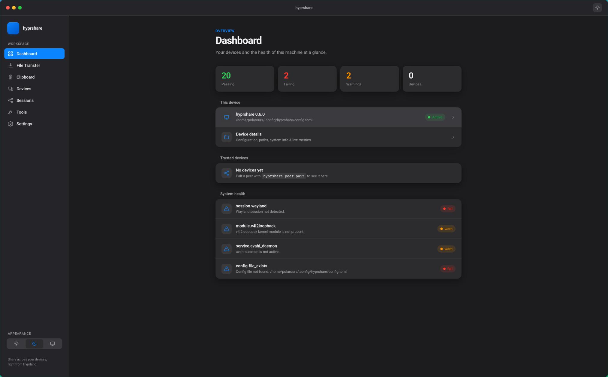
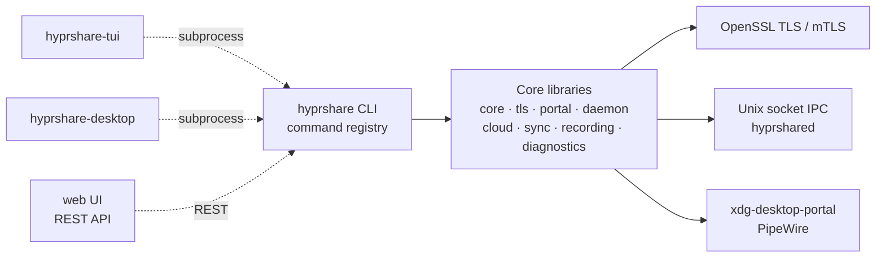

<a id="readme-top"></a>

<div align="center">


# hyprshare

**One install. Every way to share — CLI, terminal UI, desktop app, and web.**

A Linux-native sharing platform built for Hyprland and Wayland. Files,
clipboard, screen capture, and trusted peers — all driven by one CLI-first
core, with four frontends that can never disagree with each other.

[](https://github.com/polarours/hyprshare/stargazers)
[](https://github.com/polarours/hyprshare/actions/workflows/ci.yml)
[](LICENSE)
[](docs/compatibility/matrix.md)
[](CMakeLists.txt)

[Install](#install) • [Why hyprshare](#why-hyprshare) • [Features](#features) • [Frontends](#frontends) • [Quick start](#quick-start) • [Docs](#documentation)

</div>



<br />

## Why hyprshare

Sharing between your Linux machines usually means stitching together `scp`,
a clipboard tool, a screenshot utility, and a hand-rolled HTTP server. Each
has its own trust model and its own quirks — and none of them talk to each
other.

hyprshare gives you one tool that covers the whole path:

- **One identity per device**, with offline invitations, pairing, and mDNS
  discovery — no account, no cloud, no third-party relay.
- **One transfer primitive** — a *session* — that every frontend stages,
  serves, and fetches the same way.
- **One install** on Arch Linux provides the CLI, daemon, TUI, desktop GUI,
  and web UI. The frontends are thin subprocess callers of the CLI, so a
  command behaves identically everywhere.

## Features

| | |
|---|---|
| 📦 **File & folder sharing** | Stage a session, serve it with a token and lifetime, fetch from the peer side. Checksums and payload verification built in. |
| 📥 **HTTP inbox** | Receive uploads over LAN with token auth, extraction, size limits, and transfer history. |
| 📋 **Clipboard** | Read/write plus cross-device sync with persistent history. |
| 🖥️ **Screen capture & recording** | xdg-desktop-portal + PipeWire, OBS fallback, MP4/WebM/MKV encoding via ffmpeg. |
| 🔐 **TLS/mTLS transport** | OpenSSL with self-signed X.509 v3 certificates. |
| 🤝 **Peer trust** | Per-device identity, offline invitations, pairing, Avahi discovery. |
| 🧩 **34 CLI commands** | sync, cloud, backup, search, monitor, netdiag, tls, plugin, batch, daemon, update, profile, and more. |
| 🔌 **Plugin system** | Shared objects contribute new CLI commands at runtime. |

See the [implementation status table](docs/architecture/overview.md) for what
is complete and what is planned.

## Frontends

| Frontend | Launch | What it is |
|---|---|---|
| **CLI** | `hyprshare --help` | 34 commands, the single source of truth |
| **TUI** | `hyprshare-tui` | ratatui dashboard — device, inbox, clipboard, receiver control |
| **Desktop** | `hyprshare-desktop` | Tauri window with seven pages and light/dark/system themes |
| **Web** | `hyprshare web serve` | REST API + React frontend at `http://127.0.0.1:8080/` |

Every frontend is a subprocess caller of the CLI.

## Install

Arch Linux (one AUR package provides everything):

```bash
yay -S hyprshare
```

See [packaging/arch/](packaging/arch/README.md) for details and manual
installation.

## Quick start

```bash
hyprshare doctor                                   # check your environment

# Send a file to another machine
hyprshare share file photo.jpg                     # machine A: stages a session
hyprshare session serve <id> --generate-token      # machine A: serve it
hyprshare session fetch <host:port> --token <t> --to ~/recv   # machine B

# Receive files from another device
hyprshare inbox serve --generate-token             # this machine: listen
hyprshare inbox put <host:8888> file.jpg --token <t>          # peer: send
```

Add `--json` to any command for machine-readable output, and `--help` to any
command for its full usage.

## Architecture



- `src/lib/<module>/` — one static library per concern; public headers in
  `include/hyprshare/`
- `src/bin/hyprshare/` — CLI (command registry + one handler per command)
- `src/bin/hyprshared/` — daemon binary (Unix socket IPC)
- `desktop/` — Tauri GUI; `web/` — React frontend shared with the web UI
- `tests/unit/` — per-module test binaries registered with CTest

Decisions are recorded as [ADRs](docs/adr/README.md).

## Build from source

Requirements: CMake ≥ 3.28, Ninja, a C++23 compiler, OpenSSL, sdbus-c++,
PipeWire headers. The GUI additionally needs Rust and Node.js/npm.

```bash
cmake -S . -B build -G Ninja && cmake --build build
ctest --test-dir build --output-on-failure            # 13 test suites

cargo build --release --manifest-path tui/Cargo.toml

cd web && npm install && npm run build && cd ..
cd desktop/src-tauri && cargo build --release
```

## Documentation

- [Architecture Overview](docs/architecture/overview.md)
- [User Guide](docs/user-guide.md) · [API Reference](docs/api-reference.md)
- [Threat Model](docs/threat-model/threat-model.md) ·
  [Compatibility Matrix](docs/compatibility/matrix.md)
- [Mobile Protocol](docs/protocol/mobile.md)
- [Changelog](CHANGELOG.md)

## License

GPL-3.0-only — see [LICENSE](LICENSE).

<div align="right">

[Back to top](#readme-top)

</div>
